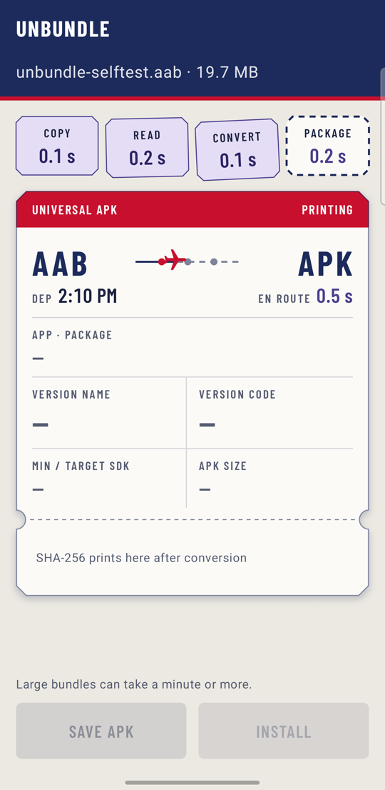
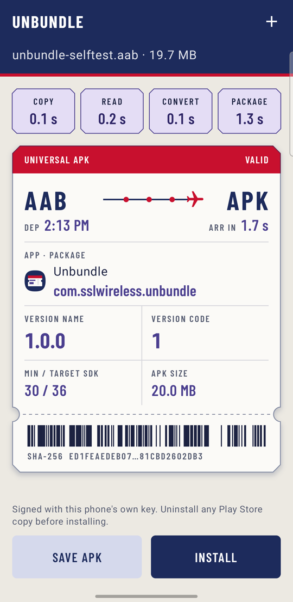
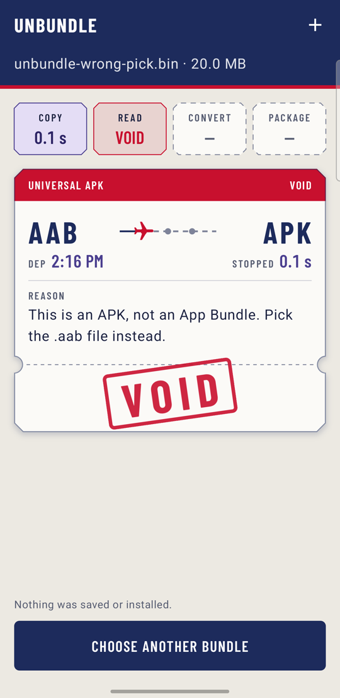
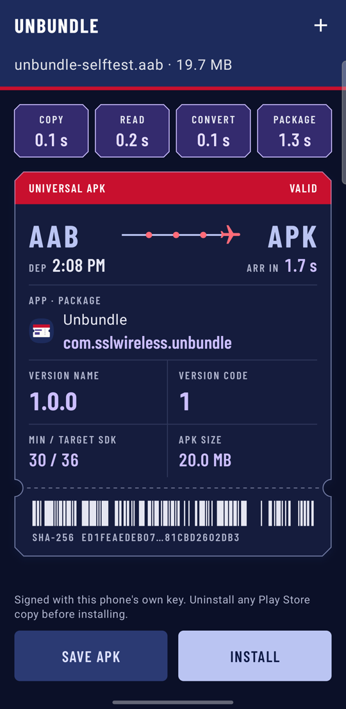

# Unbundle

Convert an Android App Bundle (`.aab`) into an installable universal APK **on the phone itself**: no desktop, no `bundletool` command line, no upload. Pick a bundle, wait while it converts, read its package and version, then save or install the APK.

<p>
  
  
  
  
</p>

## Features

- **Pick** an `.aab` with the system file picker. Images, documents and APKs are greyed out.
- **Convert** on-device with Google's [bundletool](https://github.com/google/bundletool) in universal mode and a bundled `aapt2`. Four stubs (Copy, Read, Convert, Package) show the real elapsed time of each step while a plane flies from AAB to APK.
- **Read** the result: app name and icon, package name (tap to copy), version name, version code, min/target SDK, APK size and SHA-256 (tap the barcode to copy).
- **Save** the APK anywhere through the system save dialog, or **install** it through the system package installer.
- **Errors name the cause.** For example, picking an APK by mistake says so instead of failing silently.
- Light and dark themes, large font sizes, and the system "remove animations" setting are respected.

## Requirements

- Android 11 (API 30) or newer
- An arm64 (`arm64-v8a`) device. The bundled `aapt2` is arm64 only, so x86 emulators are not supported.

## Install

1. Download `unbundle-<version>.apk` from the [Releases](../../releases) page.
2. Optionally verify it: `sha256sum -c unbundle-<version>.apk.sha256`.
3. Open the APK on your phone and allow your browser or file manager to install unknown apps when Android asks.

To install converted APKs from inside Unbundle, Android also asks once to allow Unbundle to install unknown apps.

## Things to know

- **Converted APKs are signed with a key generated on your phone.** The key lives in the Android Keystore and never leaves the device. Because it is not the Play Store key:
  - An APK converted by Unbundle cannot update a copy installed from Play. Uninstall that copy first.
  - APKs converted on two different phones have different signatures, so one cannot update the other.
- **Universal mode** includes every language, density and ABI in one APK. Install-time feature modules are merged. On-demand feature modules and asset packs have not been tested.
- **File picker filtering** works by MIME type, not extension. Android usually types `.aab` as `application/octet-stream`, so a few other untyped files stay selectable. Unbundle checks the file and explains what it got. A file manager that labels `.aab` differently would grey out real bundles. If that happens, pick through the system's own Downloads or Files view.
- **No network access.** The app has no `INTERNET` permission. Bundles and APKs stay on the device unless you save or share them.

## How it works

1. The picked bundle is copied into the app's cache. Unbundle then checks it is a real bundle (`BundleConfig.pb` present).
2. `BuildApksCommand` from bundletool runs in universal mode, with `aapt2` executed from the app's native library directory. A proxy around bundletool's `Aapt2Command` marks when the Convert step starts and ends.
3. bundletool signs the APK with the per-device Keystore key (apksig).
4. `PackageManager.getPackageArchiveInfo` reads the label, icon, versions and SDK levels from the result.

The code lives in [`Converter.kt`](app/src/main/java/com/alifhasnain/unbundle/Converter.kt), [`UnbundleViewModel.kt`](app/src/main/java/com/alifhasnain/unbundle/UnbundleViewModel.kt) and [`ui/UnbundleScreen.kt`](app/src/main/java/com/alifhasnain/unbundle/ui/UnbundleScreen.kt). Visual design is documented in [DESIGN.md](DESIGN.md) and product decisions in [PRODUCT.md](PRODUCT.md).

## Build from source

You need JDK 17+ and the Android SDK (platform 36). Android Studio's bundled JDK works.

```bash
./gradlew :app:assembleRelease
```

The APK lands in `app/build/outputs/apk/release/`. Without release signing variables (see below), local release builds are signed with your debug key. Every build first runs `verifyAapt2`, which fails if the bundled `aapt2` binary's SHA-256 has changed.

## Releasing

Releases are built by [`.github/workflows/release.yml`](.github/workflows/release.yml) when a tag like `v1.2.3` is pushed.

```bash
git tag v1.2.3
git push origin v1.2.3
```

The workflow then:

1. Derives `versionName` from the tag (`1.2.3`) and `versionCode` from it (`1*10000 + 2*100 + 3 = 10203`). Minor and patch must stay below 100.
2. Decodes the release keystore from secrets and builds a signed `assembleRelease`.
3. Publishes a GitHub Release with `unbundle-1.2.3.apk`, its `.sha256`, and generated release notes.

It refuses to publish if the keystore secret is missing, so a release is never debug-signed.

### One-time setup

Create a release keystore and keep it backed up somewhere safe outside the repository. If it is lost, future releases cannot update installed copies.

```bash
keytool -genkeypair -v -keystore unbundle-release.jks -alias [KEY_ALIAS] -keyalg RSA -keysize 4096 -validity 10000
```

Add these repository secrets under **Settings → Secrets and variables → Actions**, or with the GitHub CLI:

| Secret | Value |
|---|---|
| `SIGNING_KEYSTORE_BASE64` | The keystore file, base64-encoded |
| `SIGNING_STORE_PASSWORD` | `[STORE_PASSWORD]` |
| `SIGNING_KEY_ALIAS` | `[KEY_ALIAS]` |
| `SIGNING_KEY_PASSWORD` | `[KEY_PASSWORD]` |

```bash
base64 -w0 unbundle-release.jks | gh secret set SIGNING_KEYSTORE_BASE64
gh secret set SIGNING_STORE_PASSWORD
gh secret set SIGNING_KEY_ALIAS
gh secret set SIGNING_KEY_PASSWORD
```

On Windows PowerShell, encode the keystore with `[Convert]::ToBase64String([IO.File]::ReadAllBytes("unbundle-release.jks"))`. Never commit the keystore or passwords; `.gitignore` already excludes `*.jks` and `*.keystore`.

To build a release-signed APK locally, set the same values as environment variables: `SIGNING_STORE_FILE` (path to the `.jks`), `SIGNING_STORE_PASSWORD`, `SIGNING_KEY_ALIAS` and `SIGNING_KEY_PASSWORD`.

## Third-party components

| Component | License | Notes |
|---|---|---|
| [bundletool](https://github.com/google/bundletool) 1.18.3 | Apache-2.0 | Maven dependency |
| [aapt2](https://github.com/ReVanced/aapt2/releases/tag/v1.1.0) (ReVanced build of AOSP aapt2) | GPL-3.0 | Bundled binary run as a separate program; see [third_party/aapt2](third_party/aapt2) |
| [Barlow Condensed](https://github.com/jpt/barlow) | SIL OFL 1.1 | Bundled font; see [third_party/barlow-condensed](third_party/barlow-condensed) |
| Material Symbols (`flight`, `add`) | Apache-2.0 | Vector paths in `res/drawable` |
| AndroidX / Jetpack Compose | Apache-2.0 | Maven dependencies |

## License

Copyright 2026 Alif Hasnain

Unbundle's own code is licensed under the [Apache License 2.0](LICENSE). Bundled third-party components keep their own licenses (see above). In particular, the `aapt2` binary is GPL-3.0 and is distributed alongside the app as a separate program; its license and source link are in [third_party/aapt2](third_party/aapt2).
